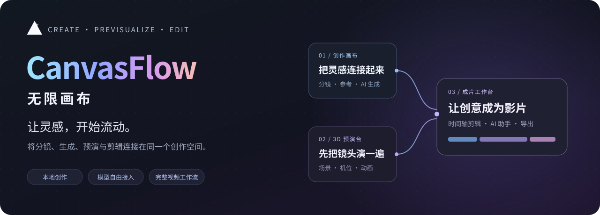
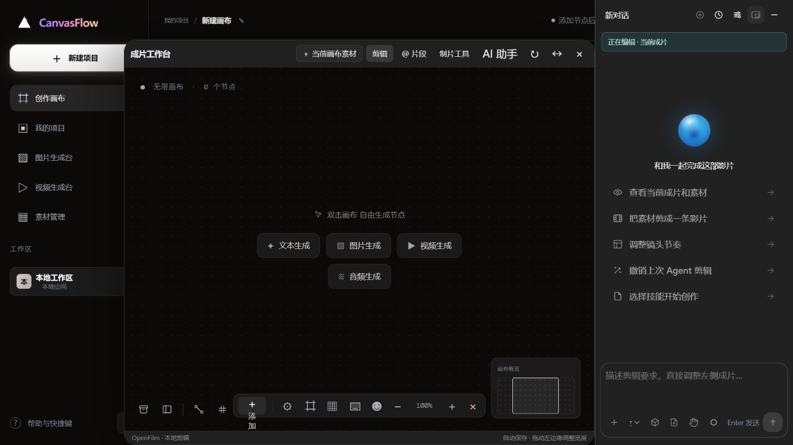
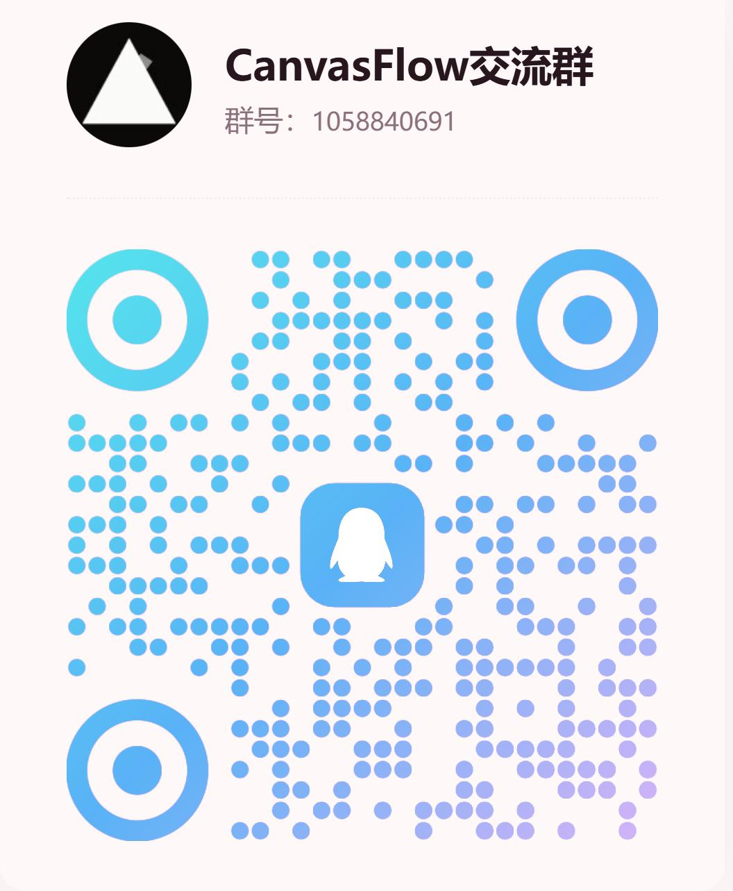

<p align="center">
  <a href="https://video.zzzapi.xyz/"></a>
</p>

<h1 align="center">CanvasFlow 无限画布</h1>

<p align="center">
  <strong>连接无限画布、AI 生成、3D 预演与 AI 剪辑的本地创作工作台。</strong>
</p>

<h3 align="center"><a href="https://video.zzzapi.xyz/">前往官网，下载 Windows 版 →</a></h3>

<p align="center">在本地，把创意、分镜和素材剪成一部片。</p>

<p align="center">
  <a href="#download">下载与安装</a> ·
  <a href="#features">主要功能</a> ·
  <a href="#previs">3D 预演台</a> ·
  <a href="#sponsors">赞助商</a> ·
  <a href="#community">社区交流</a>
</p>

<p align="center"><sub>当前先发布项目介绍，源码与配套文档将随后上传。页面展示开发版工作流，新功能的桌面发行进度以对应版本发布说明为准。</sub></p>

<p align="center">
  
  <br><sub>CanvasFlow 开发版界面 · 创作画布与 AI 助手</sub>
</p>

**CanvasFlow 是一个以无限画布为入口的本地 AI 视频创作工作台。** 从脚本和分镜开始，用节点组织参考素材与生成结果，在 3D 场景中试机位和运镜，再把镜头送进成片工作台剪辑、预览与导出。项目和素材保存在本机，在线模型服务由你选择。

<a id="download"></a>

## 下载与安装

| 平台 | 获取方式 | 说明 |
| --- | --- | --- |
| Windows x64 | [前往官方网站下载](https://video.zzzapi.xyz/) | 下载安装程序，按向导选择安装位置并完成安装 |
| macOS | 适配中 | 暂未提供经过实机验证的安装版本，后续进展会在本仓库同步 |

安装版可直接启动桌面应用。在线生成需要自行配置模型服务；源码运行方法见下方「本地运行与开发」。

### 关于 macOS 适配的致歉说明

向使用苹果电脑的朋友们说声抱歉：目前我们还没有苹果设备，暂时无法完成 CanvasFlow 在 macOS 上的适配与实机验证，因此当前尚未提供经过验证的 macOS 安装版本。

我们会尽快补充苹果设备的适配与测试，完成后及时发布 macOS 版本及使用说明。感谢大家的理解与耐心等待。

<a id="sponsors"></a>

## ❤️ 赞助商

<table>
  <thead><tr><th align="center">Logo</th><th>简介</th></tr></thead>
  <tbody>
    <tr>
      <td align="center" width="150"><a href="https://ai.zzzapi.xyz/"></a></td>
      <td>
        <a href="https://ai.zzzapi.xyz/"><strong>CanvasFlow API 开放平台</strong></a><br>
        感谢 <strong>CanvasFlow API 开放平台</strong> 为本项目提供支持！平台提供统一的模型 API 接入，覆盖文本、图片、视频和音频能力，将文案创作、图片生成、视频生成与配音连接到同一套创作流程，无需在本地部署 AI 模型。可在 CanvasFlow 的供应商设置中配置使用。<br><br>
        <a href="https://ai.zzzapi.xyz/"><strong>立即注册 →</strong></a>
      </td>
    </tr>
  </tbody>
</table>

<a id="features"></a>

## 主要功能

<table>
  <tr>
    <td width="50%" valign="top"><h3>无限创作画布</h3><p>用文本、图片、视频和音频节点拆分脚本、组织分镜，连接上游参考素材，让创作过程与素材关系清晰可见。</p></td>
    <td width="50%" valign="top"><h3>图片与视频生成台</h3><p>通过独立生成界面编写提示词、选择模型、设置生成参数并查看结果，配合画布完成不同创作任务。</p></td>
  </tr>
  <tr>
    <td width="50%" valign="top"><h3>3D 导演台与预演台</h3><p>摆放角色和道具、调整机位与动画，在场景调度和成片预演之间切换，提前检查构图、运动和镜头节奏。</p></td>
    <td width="50%" valign="top"><h3>AI 成片工作台</h3><p>集成 OpenFilm 的时间轴、预览、渲染与导出。可以手动剪辑，也可配置 AI 助手按指令编辑当前成片工程。</p></td>
  </tr>
  <tr>
    <td width="50%" valign="top"><h3>工作区素材管理</h3><p>集中管理图片、视频、音频和 3D 模型，按项目、类型和自定义标签筛选，方便查找、整理和重复使用素材。</p></td>
    <td width="50%" valign="top"><h3>本地 Blender 建模连接</h3><p>连接本机 Blender，通过应用内的建模工具创建和修改模型，再加入 3D 场景。保留源工程版本，便于继续调整。</p></td>
  </tr>
</table>

## 一条视频可以怎么做

1. **在画布上拆分镜。** 用文本、图片、视频和音频节点组织脚本、参考和生成结果。把角色图连到需要它的镜头，回头就能看到这个镜头用了哪些素材。
2. **在 3D 导演台搭景，用预演台检查镜头。** 摆放角色和道具，调整机位与动画，在场景调度和成片预演之间切换，检查构图、运镜和节奏，再把截图或预演视频带回画布。
3. **手动剪，或让 AI 助手先剪一版。** 从当前画布导入图片、视频和音频，拖进时间轴。也可以对助手说：“把这三个片段剪成 15 秒，先展示成品，再交代过程，结尾加上标题。”助手可以按指令编辑工程，你可以在时间轴上检查、修改并导出。

工作区素材库可以按类型、项目和自定义标签筛选。图片、视频、音频和 3D 模型都能在这里管理，下次做新项目时也容易找回。

<a id="previs"></a>

## 3D 预演台：先把镜头演一遍

正式生成或剪辑前，可以先在 3D 导演台摆好角色、道具和机位，再进入预演台检查镜头。两者共用同一份场景和动画，调整后的内容可以继续编辑。

- **场景调度。** 调整对象的位置、旋转和缩放，从导演视角查看角色站位与空间关系，同时通过机位预览检查构图。
- **成片预演。** 切换到机位视角，按时间轴播放镜头；支持拖动播放进度、调整播放速度、循环播放和设置画幅，方便反复检查运动与节奏。
- **角色与运镜动画。** 在导演台通过关键帧、角色动作和运动路径安排调度，再到预演台查看角色运动、镜头移动及机位切换的效果。
- **把预演带回创作流程。** 将当前画面截图或导出预演视频到画布，用于参考、后续生成或导入成片工作台做粗剪。
- **连接本地 Blender。** 准备好 Blender 运行环境后，可以通过应用中的建模工具创建和修改模型，再加入场景继续预演。

例如，一个“人物走近窗边、镜头缓慢推进”的镜头，可以先搭建简化场景，安排人物路径与机位运动，播放检查构图和时长，再把预演结果带回画布继续创作。

<a id="development"></a>

## 本地运行与开发

> 源码与配套文档正在整理上传。以下说明适用于取得完整源码后的本地开发环境。

<details>
<summary><strong>展开 Windows 源码启动与模型配置说明</strong></summary>

在源码根目录打开 PowerShell，使用 Python 3.10 或更新版本启动：

```powershell
python launch_local.py --port 5181 --no-open
```

用浏览器打开终端输出的地址。端口占用时，启动器会选择空闲端口。服务监听 `127.0.0.1`；首次运行会创建 `server-data/`，也可通过 `CANVASFLOW_DATA_DIR` 指定独立的数据目录。

画布、素材管理和本地剪辑无需注册 CanvasFlow 账号。在线生成需要在「偏好设置 → 供应商设置」中填写自己的 API Key，拉取并启用所需模型。任务需要的提示词和参考素材会发送给所选供应商，费用按该服务的规则结算。

| 使用目标 | 随源码提供的说明 |
| --- | --- |
| 准备成片编辑器、剪辑导出和 AI 助手 | `FILM_WORKBENCH.md` |
| 连接本地 Blender 建模 | `BLENDER_BRIDGE.md` |
| 运行回归测试 | `tests/README.md` |
| 构建与发布桌面安装包 | `RELEASING.md` |

</details>

## 致谢

**特别感谢 OpenFilm 团队与贡献者开源了 AI 视频剪辑工具。** CanvasFlow 的成片工作台集成了 OpenFilm 0.3.2 的 Studio 和剪辑引擎，复用了它的时间轴、预览、渲染、导出和 Agent 剪辑能力。CanvasFlow 将这些能力接入自己的创作画布、素材库和助手，让当前项目的素材可以进入时间轴，让助手和创作者可以编辑同一份成片。OpenFilm 的 MIT 许可及版权声明随相关组件保留。[OpenFilm 源码与文档](https://github.com/openfilm/openfilm)

**感谢 Blender 基金会和开源社区。** CanvasFlow 通过本地 Blender 连接，让创作者可以在 3D 预演工作流中使用 Blender 建模。[Blender 官方源码仓库](https://github.com/blender/blender)

也感谢 Three.js 和 Mediabunny 的贡献者。它们分别支持 CanvasFlow 的 3D 场景显示和预演视频封装。第三方组件的版本及许可证将在源码上传时一并提供。

<a id="community"></a>

## 社区交流

欢迎交流使用问题、创作技巧与项目进展，也欢迎参与测试和开发。

<table>
  <thead><tr><th align="center">CanvasFlow QQ 交流群</th><th>联系与反馈</th></tr></thead>
  <tbody>
    <tr>
      <td align="center" width="300"><a href="docs/images/qq-group.jpg"></a><br>群号：<strong>1058840691</strong><br><sub>使用 QQ 扫码加入，或搜索群号。</sub></td>
      <td valign="top"><strong>邮箱联系</strong><br><a href="mailto:3161751283@qq.com">3161751283@qq.com</a><br><br><strong>问题反馈与功能建议</strong><br><a href="https://github.com/peixiaoxuexugeyuan/CanvasFlow/issues">提交 GitHub Issue →</a><br><br>反馈时请附上系统版本、操作步骤和可复现的示例，方便定位问题。</td>
    </tr>
  </tbody>
</table>

## 欢迎一起改进

欢迎通过 Issue 分享需求和问题，也欢迎在源码上传后通过 Pull Request 贡献供应商适配、剪辑功能、文档或示例项目。

<p align="center"><strong>如果 CanvasFlow 帮到了你，请在 GitHub 点个 Star，这对我们意义重大。</strong></p>
